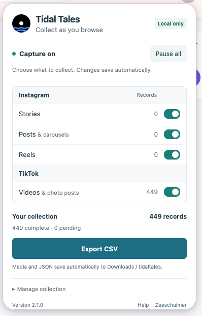

---
format:
  html: default
title: "TikTok"
date: 2026-11-02
bibliography: ../literature.bib
author:
  - name: Michael Achmann-Denkler
    id: ma
    orcid: 0000-0002-4754-7842
    email: michael.achmann@informatik.uni-regensburg.de
citation:
  type: webpage
  doi: 10.5281/zenodo.10039756
license: CC BY
---

TikTok research often starts with browsing: we follow selected accounts, search for a topic, or explore a hashtag. Browser extensions allow us to capture the data TikTok delivers during these activities. For our winter 2026/27 seminar, I recommend the [Tidal Tales Firefox plugin](https://github.com/michaelachmann/tidal-tales-plugin) as the primary approach: it downloads videos, images from photo posts, and their metadata directly to disk while we browse. This gives us a local collection for later text, image, and video analysis.

The [Digital Methods Initiative's TikTok guide](https://docs.google.com/document/d/19MAiqX7Vx1FcNJ44K-vSdnKDVC5gcFwtrSQiewnwW8A/edit?pli=1) remains a useful introduction to query design and the alternative Zeeschuimer & 4CAT workflow. Tidal Tales builds on [Zeeschuimer](https://github.com/digitalmethodsinitiative/zeeschuimer), with an emphasis on saving media and metadata locally during collection. We do not need to set up a 4CAT server for the workflow below.

If you prefer a managed collection service, [Apify's TikTok Scraper](#apify-tiktok-scraper) is an alternative for collecting from specified profiles, hashtags, search queries, or post URLs.

::: {.callout-note}
### Work in progress: Sampling and systematic collection

Our sampling strategy is still open. This session introduces the collection tools; developing a proposal for how to collect data systematically is part of this week's homework. Consider which accounts or queries to include, the time window, inclusion criteria, and a stopping rule, and explain how these choices fit your research question. We will add the sampling guidance to this page in preparation for next week's session. Treat any collection you make while exploring the tools as a pilot until your sampling plan is settled.
:::

## Tidal Tales Plugin

::: {.column-margin}

:::

I originally adapted Tidal Tales for [Instagram Stories](ig-stories.qmd) [@achmanndenkler2024preservingephemeralinstagramstory]. [Version 2.1.0](https://github.com/michaelachmann/tidal-tales-plugin/releases/tag/v2.1.0) also supports TikTok videos and photo posts. The extension stores raw JSON metadata and downloads the available media through Firefox. It also keeps collection records in a local browser database, from which we can export a CSV table.

Saving media during browsing is particularly useful because TikTok's media URLs can expire. A table containing links alone may no longer give us access to the images or videos when we start the analysis. Tidal Tales starts downloading them during collection, although downloads can still fail or remain incomplete.

### Plugin Installation

The [Tidal Tales website provides an installation guide](https://tidaltal.es/plugin/#installation). The steps below show how to install the Firefox extension for our TikTok workflow.

1. Open the [latest release on GitHub](https://github.com/michaelachmann/tidal-tales-plugin/releases/latest) in [Firefox](https://www.mozilla.org/firefox/new/).
2. Under **Assets**, download the signed `.xpi` file. The source-code ZIP and TAR.GZ files are not installers.
3. In Firefox, open `about:addons`, click the gear icon, and choose **Install Add-on From File…**.
4. Select the `.xpi` file and confirm the installation and requested permissions.

If Tidal Tales is already installed, installing the newer release updates it without first removing the extension. You can find its interface through the extensions button in Firefox's toolbar.

### Collecting TikTok Posts

For a first pilot, try the steps below with a small set of posts. For the systematic collection, we will need to define which accounts or queries to study, the relevant time period, and a stopping rule as part of the sampling homework above. Keep your provisional choices in your research notes so that you can explain how the pilot dataset was constructed.

{#fig-tidal-tales-tiktok width=360 fig-alt="Tidal Tales 2.1.0 popup with capture enabled, separate Instagram and TikTok switches, 449 TikTok records, a collection summary reading 449 complete and 0 pending, and an Export CSV button."}

In @fig-tidal-tales-tiktok, **Capture on** means that new items can be recorded. The switches select which content types to collect; all are enabled in this example, but only TikTok records have been captured. **Your collection** shows 449 records, with 449 complete and none pending. This is the extension's download status; we should still inspect a few saved files. **Export CSV** downloads the metadata table, while the media and JSON files are already saved in `Downloads/tidaltales`.

1. Open the Tidal Tales interface. Enable **TikTok → Videos & photo posts** and disable the Instagram switches if you only want to collect TikTok. All capture switches are initially enabled.
2. Check that capture is active. If it is paused, click **Resume capture** and reload any TikTok page that was already open.
3. Browse the accounts, searches, or hashtags specified in your collection plan. Open individual posts when previews provide incomplete metadata or media links.
4. Check the collection count and download status in the extension. Start with a small pilot and open a few downloaded files before expanding the collection.
5. When finished browsing, click **Pause all** to stop new capture. Keep Firefox running until queued downloads finish; pausing does not cancel them.
6. Check records needing attention. If media failed to download, revisit the post with capture enabled to obtain fresh media URLs, then check the result again.
7. Click **Export CSV** to save the collection table.

::: {.callout-note}
### What does a captured item mean?

The extension captures data delivered to the browser, including posts TikTok loads in batches. A captured item is therefore not proof that you watched it or that it appeared on screen. Search results and recommendations also depend on the browsing context. Document your queries, account/login state, collection times, and stopping rules; do not treat the resulting collection as a representative sample of TikTok.
:::

### Local Files and CSV Export

TikTok files are saved below Firefox's Downloads directory in `tidaltales/tiktok/<username>/`. Each captured item has a raw JSON metadata file, with downloaded media stored alongside it. Photo posts can have multiple image files with numbered suffixes. The [plugin README](https://github.com/michaelachmann/tidal-tales-plugin#local-files-and-capture-limitations) documents the file layout and capture limitations.

The CSV export includes metadata, platform and content type, download outcomes, and saved media paths relative to the Downloads directory. Only completed or previously verified media downloads appear as saved paths; older records may be marked as unverified. Use these paths to connect the table to local media when preparing your analysis. Keep the directory structure when moving the collection to your project workspace, and retain the raw JSON alongside the CSV.

**Export CSV exports the whole collection**, including records from modules you have since disabled. Filter by platform and your sampling criteria before analysis. Revisiting a post may create another observation while reusing its media file, so check post IDs when you need one row per post. Raw JSON files are refreshed when an item is captured again; make dated copies if your research requires separate snapshots.

Under **Manage collection**, **Clear metadata** removes browser database records after confirmation. It preserves downloaded files and does not cancel queued downloads. Export and back up your collection before clearing it.

### Pros
<ul class="pro-con-list pro">
<li>Downloads available videos, photo-post images, and metadata during browsing.</li>
<li>Stores the collection locally, without an additional server or backend.</li>
<li>Exports a CSV table connecting metadata to saved media files.</li>
</ul>

### Limitations
<ul class="pro-con-list con">
<li>Requires browsing and a documented sampling strategy.</li>
<li>Captures only data delivered by TikTok; previews may omit fields or media URLs.</li>
<li>Downloads can fail, and platform changes can affect collection.</li>
</ul>

## Apify TikTok Scraper

The [TikTok Scraper by Clockworks on Apify](https://apify.com/clockworks/tiktok-scraper) offers a managed workflow: we specify what to collect and let the service run the collection. It supports profiles, hashtags, search queries, and individual post URLs, with metadata exports in formats including CSV and JSON. This can be useful for repeated collections without manually browsing each page. Processing and storage take place on Apify's infrastructure; we then download the results to our research workspace.

### Collecting with Apify

1. Create an Apify account and open the TikTok Scraper. Check its [current pricing](https://apify.com/clockworks/tiktok-scraper/pricing) before starting; video downloads and some filters incur additional charges.
2. Enter the profiles, hashtags, search queries, or post URLs from your sampling plan. Set a small result limit for a pilot. The number-of-videos setting applies **per hashtag, profile, or search query**.
3. Enable video downloads and, for photo posts, slideshow-image downloads. Both are disabled by default. The [input documentation](https://apify.com/clockworks/tiktok-scraper/input-schema) explains these options and optional thumbnail downloads.
4. Start the pilot, inspect the results and media, and check the cost before scaling up.
5. Export the metadata as CSV or JSON and download the collected media from Apify storage to disk. A metadata export alone does not give you a local copy of the videos or images.

Keep the run ID, collection date, input settings, and Actor version/build information with your dataset. Check the storage retention settings and save your own copy promptly. As with browser capture, inspect missing items and apply your inclusion criteria; a result limit does not guarantee complete coverage of a topic or account.

For our seminar, Tidal Tales remains the first choice for collecting directly to the local machine. Apify is an alternative when managed runs fit the project and its budget. Include the use of an external collection and storage service in your project's data-management decisions.

## Preparing for Analysis

Before moving on, check that your CSV and local files match: inspect a few videos and photo posts, review missing media and metadata, and apply your inclusion criteria. Record the Firefox and plugin versions and retain a collection log. The [data-collection introduction](index.qmd) provides the course's methodological and ethical grounding for this work.

With the collection checked, we can use captions in our [text-analysis workflow](../processing/index.qmd), prepare audiovisual material through [text preprocessing](../processing/preprocessing.qmd), or explore images with the methods in the [image-analysis section](../image-analysis/index.qmd).
