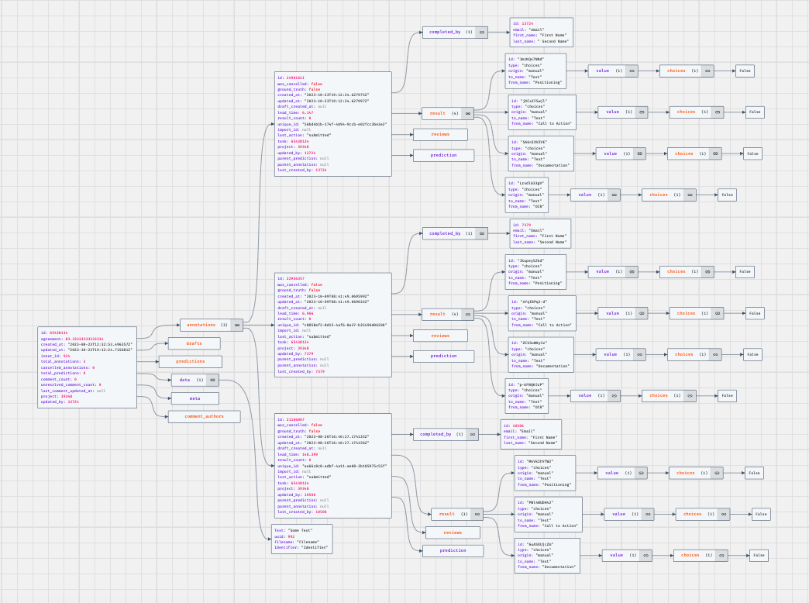
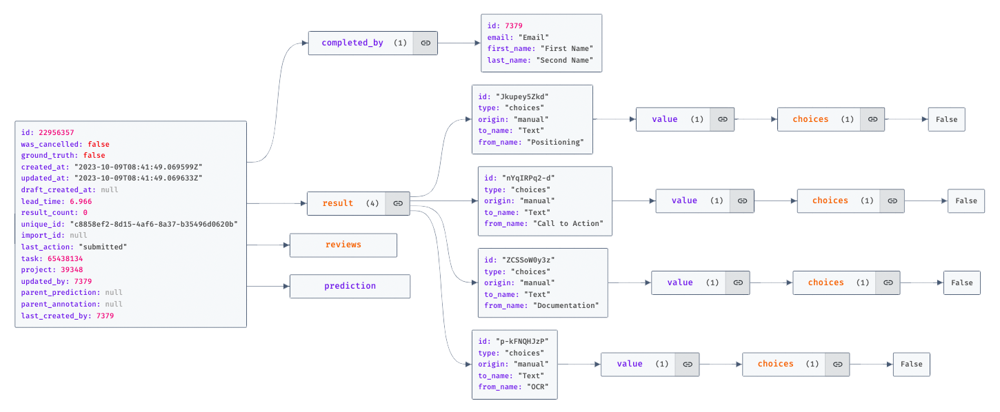
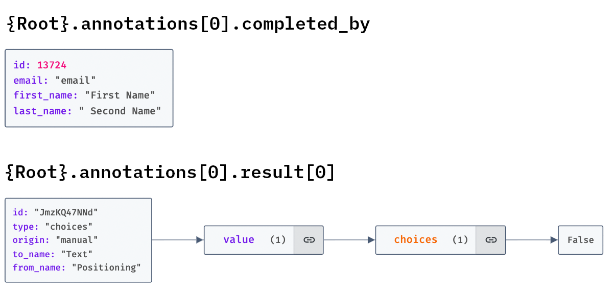

The [previous chapter](index.qmd) introduced human annotations as a basis for evaluating computational classifications. Here, we first examine whether annotators apply the coding scheme consistently, then compare model predictions with a documented reference. @Klie2024-xg emphasize quality management, including agreement assessment and manual inspection. Consistent annotations can still share a systematic error, so agreement and validity need separate attention.

We use Cohen's kappa and Krippendorff's alpha to assess annotation reliability. For model evaluation, we introduce accuracy, precision, recall, and F1. A reference dataset may support model training, prompt development, or final testing, but these roles must be kept separate to avoid optimistic performance estimates.

In the first part of the chapter we will take a look at [interrater agreements](#interrater-agreement) and [machine learning evaluation measures](#machine-learning-evaluation-metrics). In the [application part](#the-evaluation-notebook) I link to the notebook for these steps:

1. Import Label Studio Annotations
2. Calculate the interrater measures
3. Derive and document reference labels from the annotations
4. Calculate model evaluation metrics against those reference labels.

Finally, the [optimization](#conclusion-prompt-optimization) part of this page provides an outlook for how to use the evaluation metrics in order to tune your classification prompt.

::: {.callout-tip}
## Start the evaluation notebook

[Open Evaluation Notebook V3 in Colab](https://colab.research.google.com/github/michaelachmann/social-media-lab/blob/main/notebooks/2024_12_09_Evaluation_Kurs_V3.ipynb){.btn .btn-primary}

Use the notebook to import Label Studio exports and evaluate your annotations and classifications. [View the notebook on GitHub](https://github.com/michaelachmann/social-media-lab/blob/main/notebooks/2024_12_09_Evaluation_Kurs_V3.ipynb) before running it. The examples on this page explain the measures; the notebook provides the practical workflow.
:::


## Interrater Agreement

### Cohen's $\kappa$
Cohen's kappa measures agreement between two annotators assigning categorical labels to the same items. It adjusts observed agreement for the agreement expected from the annotators' individual label frequencies:

$\kappa = \frac{p_o - p_e}{1 - p_e}$

Here, $p_o$ is the proportion of matching labels and $p_e = \sum_c p_{1c}p_{2c}$, where $p_{1c}$ and $p_{2c}$ are the proportions assigned to category $c$ by each annotator. A value of 1 indicates perfect agreement, 0 agreement at the chance baseline, and a negative value agreement below that baseline. If both annotators assign the same single category to every item, $p_e=1$ and kappa is undefined, despite perfect observed agreement. Label prevalence matters: report label distributions and observed agreement alongside kappa. Agreement alone does not establish that the labels measure the intended concept.

See the [scikit-learn documentation for Cohen's kappa](https://scikit-learn.org/stable/modules/generated/sklearn.metrics.cohen_kappa_score.html) for the definition and implementation.

::: {.interactive-widget}
<h4>Interactive Example</h4>
<p>Choose a disagreement percentage and the number of items. Coder 1 assigns each of the two categories equally often; Coder 2 changes a fixed number of those labels. Each item is changed at most once, so the result is reproducible. The requested percentage is rounded to a whole number of items; the actual disagreement is shown below.</p>

```{ojs}
//| echo: false

function generateControlledCoding(nItems, disagreementRate) {
    const coder1 = Array.from({length: nItems}, (_, i) => i % 2);
    const nDisagreements = Math.round(nItems * disagreementRate / 100);
    const coder2 = coder1.map((label, i) => i < nDisagreements ? 1 - label : label);
    return [coder1, coder2];
}

function calculateCohensKappa(coder1, coder2) {
    const n = coder1.length;
    if (n === 0) return null;
    const observed = coder1.filter((label, i) => label === coder2[i]).length / n;
    const p1 = coder1.filter(label => label === 1).length / n;
    const p2 = coder2.filter(label => label === 1).length / n;
    const expected = p1 * p2 + (1 - p1) * (1 - p2);
    return expected === 1 ? null : (observed - expected) / (1 - expected);
}

function drawCodingPlot(coder1, coder2) {
    const width = coder1.length * 10 + 65;
    const svg = d3.create("svg")
        .attr("viewBox", `0 0 ${width} 60`)
        .attr("role", "img")
        .attr("aria-label", "Two rows of annotation labels: filled circles represent category 1, outlined circles category 0.")
        .style("width", "100%")
        .style("max-width", `${width}px`);
    [coder1, coder2].forEach((coder, row) => {
        svg.append("text").attr("x", 45).attr("y", 20 + row * 25)
            .attr("text-anchor", "end").attr("fill", "currentColor")
            .attr("font-size", 10).text(`Coder ${row + 1}`);
        coder.forEach((label, i) => svg.append("circle")
            .attr("cx", 60 + i * 10).attr("cy", 16 + row * 25).attr("r", 3.5)
            .attr("fill", label === 1 ? "currentColor" : "none")
            .attr("stroke", "currentColor"));
    });
    return svg.node();
}

viewof disagreement_rate = Inputs.range([0, 100], {step: 1, value: 10, label: "Requested disagreement (%)"})
viewof nItems = Inputs.range([10, 60], {step: 2, value: 60, label: "Number of items"})

{
    const [coder1, coder2] = generateControlledCoding(nItems, disagreement_rate);
    const disagreements = coder1.filter((label, i) => label !== coder2[i]).length;
    const observed = 1 - disagreements / nItems;
    const kappa = calculateCohensKappa(coder1, coder2);
    return html`<div aria-live="polite">
        <p><strong>Cohen's kappa: ${kappa === null ? "Undefined" : kappa.toFixed(2)}</strong><br>
        Disagreements: ${disagreements} / ${nItems} (${(100 * disagreements / nItems).toFixed(1)}%).
        Observed agreement: ${(100 * observed).toFixed(1)}%. Expected agreement: 50.0%.</p>
        ${drawCodingPlot(coder1, coder2)}
        <p>Filled circle = category 1; outlined circle = category 0.</p>
    </div>`;
}
```

The 50% chance baseline is a property of this deliberately balanced example. It is not a general constant for binary annotation tasks.
:::


Using python we can easily calculate Cohen's Kappa:

```python
from sklearn.metrics import cohen_kappa_score

# Example annotations from two annotators
annotator1 = [1, 2, 3, 4, 5]
annotator2 = [2, 2, 3, 4, 4]

kappa = cohen_kappa_score(annotator1, annotator2)
print(f"Cohen's Kappa: {kappa}")
```

### Krippendorff's $\alpha$

Krippendorff's alpha can be used with two or more annotators and can accommodate missing annotations. Choose a disagreement function appropriate to the measurement level: nominal categories, ordered categories, or numerical measurements.

$\alpha = 1-\frac{D_o}{D_e}$

Here, $D_o$ is observed disagreement and $D_e$ is expected disagreement under the chance model. A value of 1 indicates perfect agreement, 0 the chance baseline, and negative values disagreement above that baseline. Alpha is undefined when expected disagreement is zero. Do not interpret agreement as proof of validity or adopt a universal cutoff without considering the task and intended use.

#### Nominal annotations in Python

Install the [`krippendorff` package](https://github.com/pln-fing-udelar/fast-krippendorff) in your notebook environment. Rows must represent annotators and columns the same items in the same order. Use `np.nan` for missing annotations.

```python
import krippendorff
import numpy as np

# Rows = annotators; columns = shared items.
# These numbers are category IDs, not numerical measurements.
data = np.array([
    [1, 2, 3, 4, 5],
    [2, 2, 3, 4, 4],
    [1, 2, 4, 4, 5]
])

alpha = krippendorff.alpha(data, level_of_measurement="nominal")
print(f"Krippendorff's alpha: {alpha:.3f}")  # 0.512
```

For string labels, use one shared mapping across all annotators. Encoding nominal labels as integers does not make the distances between those integers meaningful. Specify `level_of_measurement="nominal"`; the package's default is `"interval"`.

```python
data_categorical = [
    ["yes", "no", "yes", "maybe", "no"],
    ["no", "no", "yes", "maybe", "maybe"],
    ["yes", "no", "maybe", "maybe", None]
]

label_encoding = {"yes": 0, "no": 1, "maybe": 2}
data_encoded = np.array([
    [np.nan if item is None else label_encoding[item] for item in row]
    for row in data_categorical
])

alpha = krippendorff.alpha(data_encoded, level_of_measurement="nominal")
print(f"Krippendorff's alpha: {alpha:.3f}")
```

Each item needs at least two available ratings to contribute to the agreement calculation. For ordinal data, define and document the category order; do not reuse an arbitrary nominal mapping as an ordinal scale.


## Machine Learning Evaluation Metrics
Once we have assessed annotation reliability and documented the reference-label procedure, we can compare model predictions with those reference labels. We discuss accuracy, precision, recall, and F1; each describes a different aspect of performance on the evaluated sample.

::: {.callout-warning}
This subchapter scratches the surface. Recommended reading: e.g. @Haim2023-or pp. 246--252, or machine learning textbooks. The examples were originally developed with GPT-3.5; the calculations and explanations were revised and checked in November 2026.
:::

### Understanding Confusion Matrix Components

Before diving into the metrics, it's important to understand the components of a confusion matrix: True Positives, True Negatives, False Positives, and False Negatives. Here's a brief explanation of each:

- **True Positives (TP):** These are cases where the model correctly predicts the positive class.
- **True Negatives (TN):** These are cases where the model correctly predicts the negative class.
- **False Positives (FP):** These are cases where the model incorrectly predicts the positive class (also known as a "Type I error").
- **False Negatives (FN):** These are cases where the model incorrectly predicts the negative class (also known as a "Type II error").

Throughout this page, rows represent reference (actual) labels and columns represent predictions. The following table summarizes these concepts:

|                       | Predicted Positive   | Predicted Negative   |
|-----------------------|----------------------|----------------------|
| **Actual Positive**   | True Positives (TP)   | False Negatives (FN)  |
| **Actual Negative**   | False Positives (FP)  | True Negatives (TN)   |

#### Example Scenario:

Consider a social media sentiment analysis model that classifies posts as either "Positive" or "Negative." In this context:

- A **True Positive** would be a post that is actually positive and the model also predicts it as positive.
- A **True Negative** would be a post that is actually negative and the model also predicts it as negative.
- A **False Positive** would occur if the model incorrectly classifies a negative post as positive.
- A **False Negative** would occur if the model incorrectly classifies a positive post as negative.

Understanding these components is key to interpreting the subsequent metrics which are derived from the values in the confusion matrix. For multiclass problems, calculate precision, recall, and F1 for each class against all remaining classes, then specify how you average them. Accuracy remains the fraction of correct predictions across all items.


**Accuracy: A General Overview**

Accuracy is the simplest and most straightforward metric. It represents the ratio of correctly predicted observations (both true positives and true negatives) to the total observations in the dataset. 

$\text{Accuracy} = \frac{\text{True Positives (TP)} + \text{True Negatives (TN)}}{\text{Total Observations}}$

Accuracy can be misleading, particularly in datasets where class distributions are imbalanced. In such cases, a model might appear to perform well simply by favoring the majority class, while failing to accurately predict the minority class.

**Precision: Measuring Exactness**

Precision reflects the accuracy of positive predictions. It shows how many of the items identified as positive are actually positive. This metric is vital when the costs of false positives are high.

$\text{Precision} = \frac{\text{True Positives (TP)}}{\text{True Positives (TP)} + \text{False Positives (FP)}}$

High precision means that few positive predictions are false positives. It does not directly measure the false positive rate, which uses all actual negatives as its denominator: $FP/(FP+TN)$.

**Recall: Assessing Completeness**

Recall, or sensitivity, measures the model's ability to identify all relevant instances. In other words, it shows how many of the actual positive cases were correctly identified by the model.

$\text{Recall} = \frac{\text{True Positives (TP)}}{\text{True Positives (TP)} + \text{False Negatives (FN)}}$

High recall is crucial in situations where missing a positive instance has severe implications, like in medical diagnoses.

**F1 Score: Harmonizing Precision and Recall**

The F1 Score is the harmonic mean of Precision and Recall, offering a balance between the two. It is particularly useful when you need a single metric to reflect a model's performance, especially in cases of uneven class distribution.

$\text{F}_{1} = 2 \times \frac{\text{Precision} \times \text{Recall}}{\text{Precision} + \text{Recall}}$

For a binary task, specify which class is positive. Binary F1 describes that class and ignores true negatives. It does not by itself establish robustness or good performance for every class. The equivalent count-based formula is $F_1 = 2TP/(2TP+FP+FN)$ when the denominator is nonzero.

::: {.callout-warning}
While a high F1 Score is often seen as indicative of a model's effectiveness, it's important to approach this metric with caution. The F1 Score, being a harmonic mean of precision and recall, may not comprehensively represent the performance nuances in certain contexts, especially in imbalanced datasets where either false positives or false negatives are more consequential. Refer to the criticism section in the [Wikipedia article on F1 Score](https://en.wikipedia.org/w/index.php?title=F-score&oldid=1190896206) or e.g. the paper "Performance Evaluation in Machine Learning: The Good, the Bad, the Ugly, and the Way Forward" by @Flach2019-hj.
:::

::: {.interactive-widget}
<h4>Machine Learning Metrics Calculator</h4>
<p>Adjust the confusion matrix counts. Precision, recall, and binary F1 refer to the positive class; macro F1 averages the F1 scores of both classes equally.</p>

```{ojs}
//| echo: false

viewof tp = Inputs.range([0, 100], {step: 1, value: 50, label: "True Positives (TP)"})
viewof fp = Inputs.range([0, 100], {step: 1, value: 10, label: "False Positives (FP)"})
viewof tn = Inputs.range([0, 100], {step: 1, value: 50, label: "True Negatives (TN)"})
viewof fn = Inputs.range([0, 100], {step: 1, value: 10, label: "False Negatives (FN)"})

function calculateMetrics(tp, fp, tn, fn) {
    const divide = (a, b) => b === 0 ? null : a / b;
    const positiveF1 = divide(2 * tp, 2 * tp + fp + fn);
    const negativeF1 = divide(2 * tn, 2 * tn + fp + fn);
    return {
        n: tp + fp + tn + fn,
        accuracy: divide(tp + tn, tp + fp + tn + fn),
        precision: divide(tp, tp + fp),
        recall: divide(tp, tp + fn),
        positiveF1,
        negativeF1,
        macroF1: positiveF1 === null || negativeF1 === null ? null : (positiveF1 + negativeF1) / 2
    };
}

{
    const metrics = calculateMetrics(tp, fp, tn, fn);
    const format = value => value === null ? "Undefined" : value.toFixed(3);
    return html`<div aria-live="polite">
        <p><strong>Number of items: ${metrics.n}</strong></p>
        <div style="display: flex; flex-wrap: wrap; gap: 1.5rem; align-items: start;">
            <table>
                <caption>Evaluation metrics</caption>
                <thead><tr><th scope="col">Metric</th><th scope="col">Value</th></tr></thead>
                <tbody>
                    <tr><th scope="row">Accuracy</th><td>${format(metrics.accuracy)}</td></tr>
                    <tr><th scope="row">Precision (positive)</th><td>${format(metrics.precision)}</td></tr>
                    <tr><th scope="row">Recall (positive)</th><td>${format(metrics.recall)}</td></tr>
                    <tr><th scope="row">Binary F1 (positive)</th><td>${format(metrics.positiveF1)}</td></tr>
                    <tr><th scope="row">F1 (negative)</th><td>${format(metrics.negativeF1)}</td></tr>
                    <tr><th scope="row">Macro F1 (both classes)</th><td>${format(metrics.macroF1)}</td></tr>
                </tbody>
            </table>
            <table>
                <caption>Confusion matrix: rows = reference, columns = prediction</caption>
                <thead><tr><th></th><th scope="col">Predicted positive</th><th scope="col">Predicted negative</th></tr></thead>
                <tbody>
                    <tr><th scope="row">Actual positive</th><td>TP: ${tp}</td><td>FN: ${fn}</td></tr>
                    <tr><th scope="row">Actual negative</th><td>FP: ${fp}</td><td>TN: ${tn}</td></tr>
                </tbody>
            </table>
        </div>
    </div>`;
}
```

A zero denominator is displayed as **Undefined**, rather than silently replaced by zero. For example, precision is undefined if there are no positive predictions. F1 is still zero when there are errors but no true positives; it is undefined only when that class is absent from both reference labels and predictions. Here, macro F1 always refers to the fixed two-class set and is undefined if either class F1 is undefined. Libraries may replace undefined values or omit them when averaging; report your convention. See the [scikit-learn documentation on undefined metrics](https://scikit-learn.org/stable/modules/generated/sklearn.metrics.precision_recall_fscore_support.html).

Try $TP=0$, $FP=0$, $TN=90$, $FN=10$: accuracy is 0.900, positive-class F1 is 0.000, and macro F1 is 0.474. The model never detects a positive item. This is why accuracy alone can be misleading.
:::


### Evaluation Multi-Class Models
When evaluating multi-class classification models, we often need to summarize the performance across all classes. This is where macro, micro, and weighted averages come into play. Each of these averages provides a different perspective on the model's performance and is useful in various scenarios.

* The **macro average** is calculated by taking the mean of the metrics, such as precision, recall, or F1 score, computed independently for each class. It treats all classes equally, giving equal weight to the performance on each class regardless of its frequency. 
* The **micro average** aggregates the contributions of all classes to compute the average metric. It calculates the metrics globally by counting the total true positives, false negatives, and false positives. 
* The **weighted average** calculates each metric for each class like the macro average but takes the size of the class into consideration when averaging. Therefore, it accounts for class imbalance by giving more weight to the metrics of larger classes.

Choose the averaging scheme before comparing models:

- **Macro:** gives each class equal weight; inspect per-class scores as well, especially for rare classes.
- **Weighted:** weights each class by its reference support (number of items). Strong performance on common classes can hide weak performance on rare classes.
- **Micro:** pools decisions. For single-label multiclass classification with all classes included, micro precision, recall, and F1 equal accuracy, whether or not the dataset is balanced. This equivalence does not generally hold for multilabel tasks or a subset of classes.

Macro F1 is the mean of per-class F1 scores, not the harmonic mean of macro precision and macro recall. Specify the evaluated label set, the averaging scheme, and the handling of undefined scores. See the [scikit-learn guide to multiclass averaging](https://scikit-learn.org/stable/modules/model_evaluation.html#multiclass-and-multilabel-classification).

### Reporting
When presenting the results of a machine learning model's performance, especially in the context of academic research, the method of reporting is critical. A confusion matrix, such as the one shown below, is a great visualization tool for both, single- and multi-class classification tasks, like in the example below, where I experimented with face recognition on social media images.

The confusion matrix visualizes the model's predictions in comparison to the true labels, allowing for an immediate grasp of the model's performance across various classes. It also succinctly illustrates the number of false positives, false negatives, true positives, and true negatives, providing a clear visual summary of the model's predictive power.

{width="75%"}

The color intensity in each cell corresponds to the count, with darker cells indicating higher numbers. This visual gradation allows for quick identification of which classes are being predicted accurately and which are not. 

Alongside a confusion matrix, report per-class precision, recall, F1, and support. Accuracy is an overall measure in the table below, rather than a separate score for each class.

For a reproducible teaching example, suppose three categories A, B, and C have the following counts:

| Reference / prediction | A | B | C | Support |
|------------------------|--:|--:|--:|--------:|
| A                      | 8 | 1 | 1 | 10 |
| B                      | 2 | 6 | 2 | 10 |
| C                      | 0 | 1 | 19 | 20 |

The resulting metrics are:

| Class / average | Precision | Recall | F1 | Support |
|-----------------|----------:|-------:|---:|--------:|
| A               | 0.800 | 0.800 | 0.800 | 10 |
| B               | 0.750 | 0.600 | 0.667 | 10 |
| C               | 0.864 | 0.950 | 0.905 | 20 |
| Macro           | 0.805 | 0.783 | 0.790 | 40 |
| Weighted        | 0.819 | 0.825 | 0.819 | 40 |
| Micro           | 0.825 | 0.825 | 0.825 | 40 |

Overall accuracy is $33/40 = 0.825$. These are calculated values for a hypothetical dataset. You can reproduce them with:

```python
from sklearn.metrics import accuracy_score, classification_report

y_true = ["A"] * 10 + ["B"] * 10 + ["C"] * 20
y_pred = (["A"] * 8 + ["B"] + ["C"]
          + ["A"] * 2 + ["B"] * 6 + ["C"] * 2
          + ["B"] + ["C"] * 19)

print(classification_report(y_true, y_pred, labels=["A", "B", "C"], digits=3))
print(f"Accuracy: {accuracy_score(y_true, y_pred):.3f}")
```

`classification_report` omits the micro row when it equals accuracy. In your project report, also document the sample, reference-label procedure, model version, prompt, and any excluded items. Scores describe performance on the evaluated data; they do not automatically establish performance on other populations or periods.


## Annotation Export
This section shows an example of exporting Label Studio annotations for use in the evaluation notebook. The screenshots document the setup used for this example; your interface may differ by version.

We are going to use some sample data from one of my projects. The goal was to classify three content variables for social media texts. The content was either from captions, OCR, or transcribed audio. Three annotators were tasked to code each variable.

{width="75%"}

Exporting the annotations is straightforward: On the dashboard of your project, click "Export":


Next, choose "Create New Snapshot" (Step 1). When creating the snapshot we may keep the original settings, click "Create Snapshot". The application takes you back to the previous screen. Now we're ready to click "Download" (Step 3). Your browser starts downloading a JSON file. Depending on the amount of annotations, it may take a while to open the file.


{width="50%"}

The JSON file can be quite overwhelming. I've used [this tool](https://jsoncrack.com/editor) to illustrate as a graph for a better understanding:

:::{.column-body-outset}

:::

The annotations are a list of JSON objects. Each object deals with one item (e.g. one of the texts / images provided for annotation). Each object contains metadata about the annotated items, as well a list of annotation objects (in our case we expect three items).

:::{.column-body-outset}

:::

Each of these annotation objects contains one object for each coding variable, e.g. "Positioning" or "Call to Action" in our example. For the single-choice result shown here, the selected label is in `value.choices[0]`. Results with multiple selections require the full `choices` list; other annotation types use different fields. Inspect the export schema before extracting labels.



With this structure in mind, we can start importing our annotations. The intention behind the following notebook is to work with one coding at a time. We want to create one dataframe per coding, with one row per item (=annotated text / image object), and one column per annotator. Later on we will add another column for our computational classifications.

## The Evaluation Notebook

::: {.callout-tip}
## Run the practical workflow

[Open Evaluation Notebook V3 in Colab](https://colab.research.google.com/github/michaelachmann/social-media-lab/blob/main/notebooks/2024_12_09_Evaluation_Kurs_V3.ipynb){.btn .btn-primary}

[View the notebook on GitHub](https://github.com/michaelachmann/social-media-lab/blob/main/notebooks/2024_12_09_Evaluation_Kurs_V3.ipynb).

The notebook imports Label Studio exports, calculates agreement, derives a majority-based reference, and evaluates classifications. It supports a single annotation project or separate exports per annotator; follow its import instructions for your setup. Check the selected coding variable, measurement level, missing labels, and treatment of ties before interpreting the results. A majority decision is a reference-label procedure, not a guarantee of correctness.

The [original notebook](https://github.com/michaelachmann/social-media-lab/blob/main/notebooks/2024_01_04_Evaluation_Kurs.ipynb) and [V2](https://github.com/michaelachmann/social-media-lab/blob/main/notebooks/2024_01_26_Evaluation_Kurs_V2.ipynb) remain available for reference.
:::


## Conclusion: Prompt Optimization
Use a **development set** to improve prompts and a separate **test set** for the final evaluation. Few-shot examples, error inspection, prompt selection, and threshold choices belong to development. Repeatedly inspecting test errors and changing the prompt turns that test set into development data.

1. Define the coding scheme, sampling procedure, positive class or class set, and primary metric.
2. Create independent human annotations and assess agreement. Resolve ambiguities and document how reference labels are derived, including ties and missing annotations.
3. Split development and test data before optimizing prompts. Where posts share accounts, events, or near-duplicate content, consider grouping the split to reduce leakage.
4. On development data, inspect the confusion matrix and per-class errors, revise the prompt, and record each version. See the [prompt design chapter](../processing/classification.qmd#designing-the-prompt) and @Tornberg2024-ub.
5. Freeze the chosen prompt, model version, and settings. Evaluate on the held-out test data and report the sample size, class support, per-class scores, averaging scheme, and uncertainty where feasible.

There is no universally adequate sample size of 50–150 items: the required size depends on class prevalence, the precision of the estimate, and the intended comparisons. A development sample may contain too few rare cases for meaningful evaluation.

See the [scikit-learn guidance on data leakage](https://scikit-learn.org/stable/common_pitfalls.html#data-leakage). The same separation between development and final evaluation applies to visual classification and LLM-based annotations. Human agreement and model performance answer different questions; report both.


## Further Reading
* @Resnik2010-oc: Evaluation of NLP Systems, in The Handbook of Computational Linguistics and Natural Language Processing.